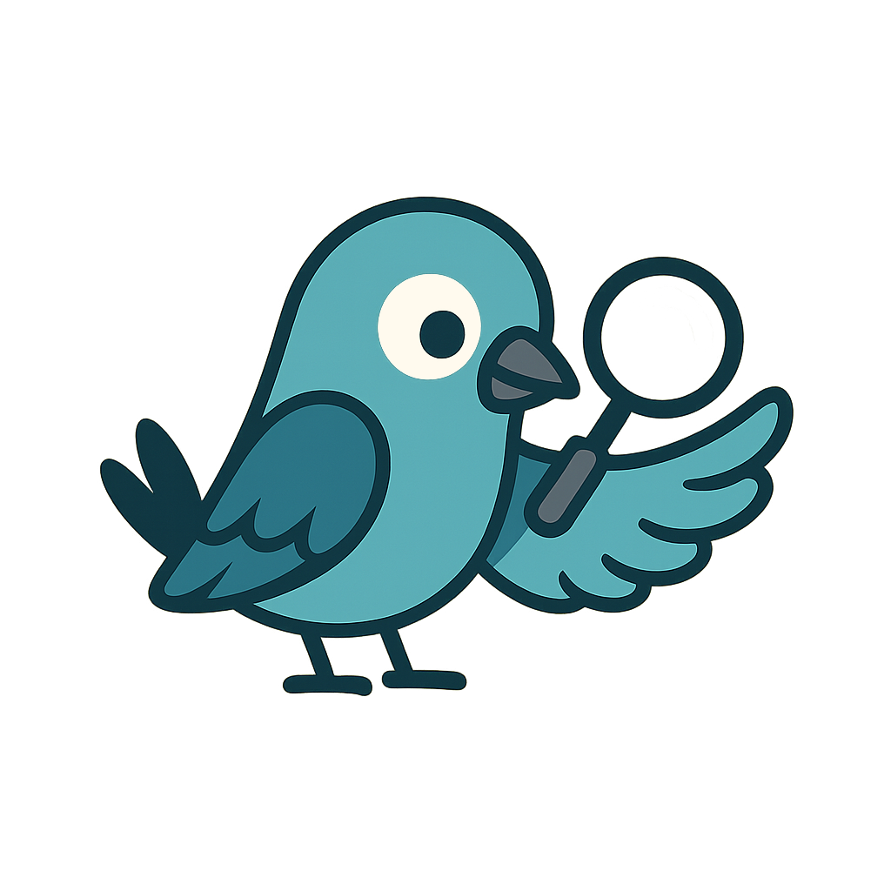
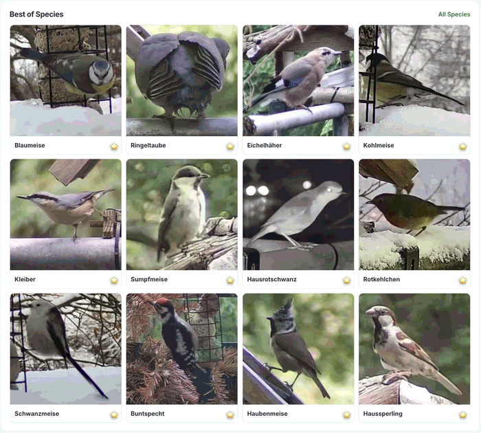
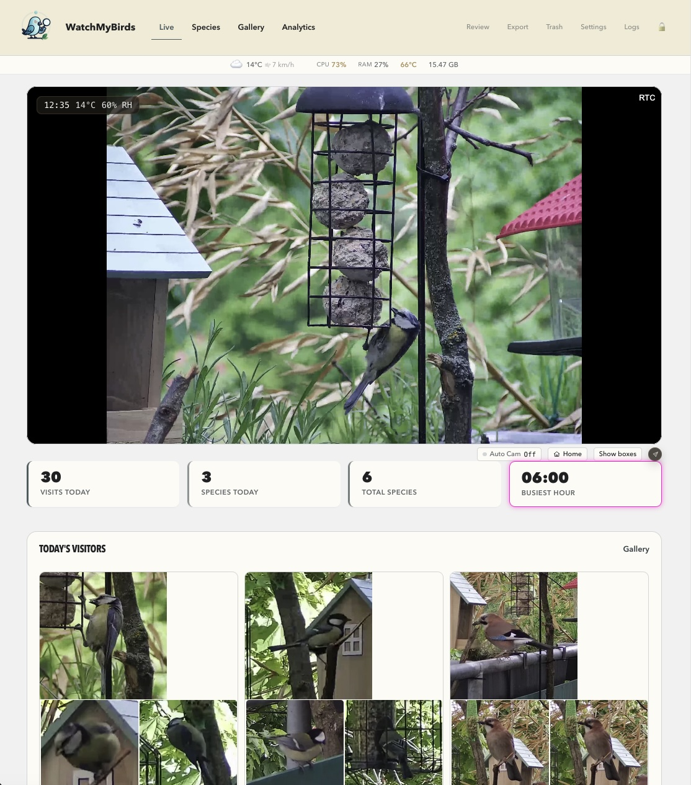
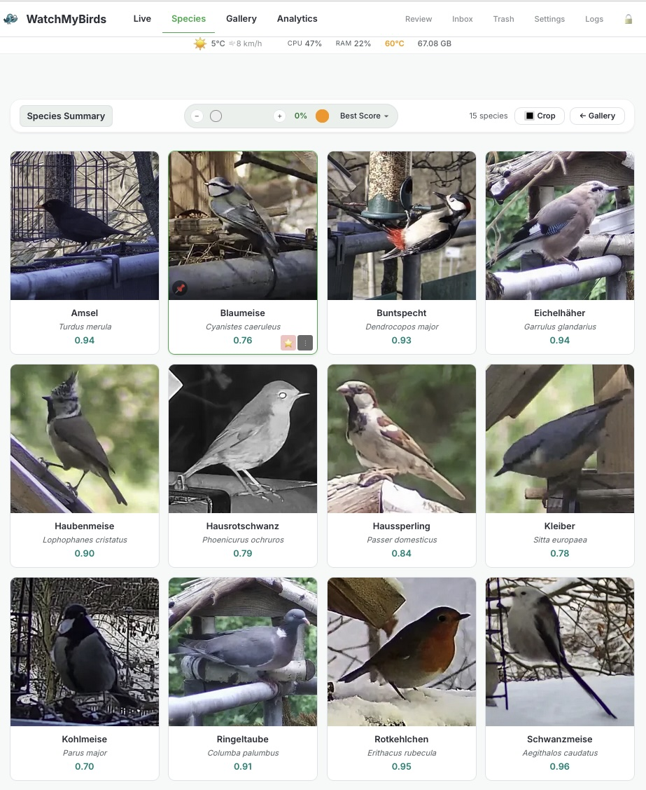
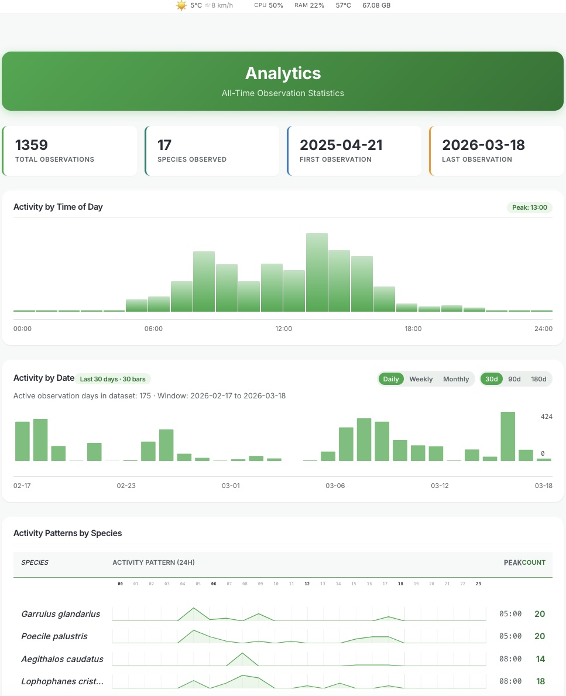
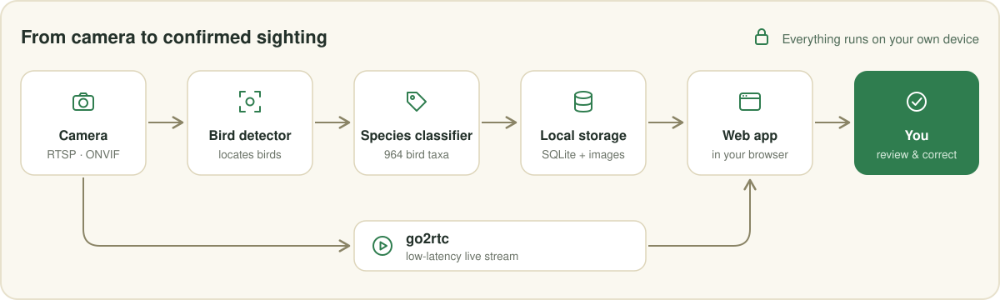
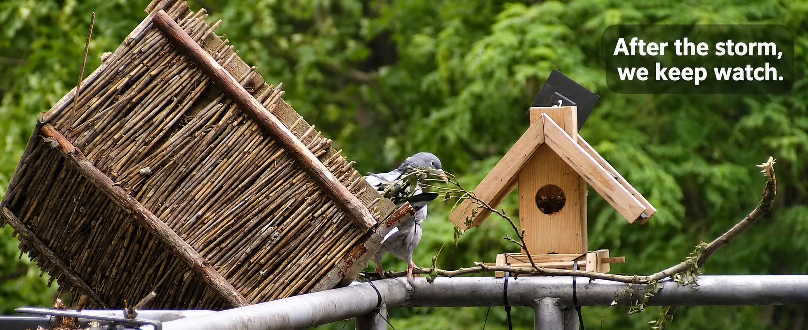

<p align="center">
  
</p>

<h1 align="center">WatchMyBirds</h1>

<p align="center">
  <a href="README.md">English</a> · <strong>Deutsch</strong>
</p>

<p align="center">
  <strong>Deine eigene Vogelbeobachtungsstation, komplett bei dir zu Hause.</strong><br>
  Richte eine Kamera auf das Futterhaus. WatchMyBirds erkennt jeden Besucher, bestimmt die Art und behält die besten Aufnahmen.
</p>

<p align="center">
  <a href="https://github.com/arminfabritzek/WatchMyBirds/releases/latest"></a>
  <a href="https://github.com/arminfabritzek/WatchMyBirds/releases/latest"></a>
  <a href="https://github.com/arminfabritzek/WatchMyBirds/actions/workflows/tests.yml?query=branch%3Amain"></a>
  <a href="LICENSE"></a>
</p>

<p align="center">
  
</p>

<p align="center">
  <a href="#schnellstart"><strong>Schnellstart</strong></a> ·
  <a href="#funktionen">Funktionen</a> ·
  <a href="#so-funktioniert-es">So funktioniert es</a> ·
  <a href="#faq">FAQ</a> ·
  <a href="#datenschutz">Datenschutz</a> ·
  <a href="#dokumentation">Doku</a>
</p>

WatchMyBirds macht aus einer Kamera und einem Raspberry Pi (oder einem
beliebigen Docker-Host) eine eigenständige Vogelbeobachtungsstation. Image
aufspielen, Kamera anschließen und zusehen, wie die Artenliste wächst. Die
Vorschläge prüfst du im Browser und korrigierst, was nicht stimmt. Kein
Cloud-Konto, kein Abo: Erkennung, Bestimmung und alle deine Bilder bleiben auf
deiner eigenen Hardware.

> **Hinweis:** Die verlinkte Detail-Dokumentation (Konfiguration, Streaming,
> Raspberry-Pi-Anleitung usw.) ist auf Englisch. Die Weboberfläche zeigt
> Artnamen in deiner Sprache an.

## Funktionen

<table>
  <tr>
    <td width="33%" valign="top">🐦 <strong>Erkennt und bestimmt Vögel</strong><br>Ein Vogeldetektor und ein Artklassifikator mit 964 Vogeltaxa beobachten die Kamera rund um die Uhr.</td>
    <td width="33%" valign="top">🏠 <strong>Lokal von Grund auf</strong><br>Keine Cloud und kein Konto. Optionale Berichte sind standardmäßig aus.</td>
    <td width="33%" valign="top">🍓 <strong>Fertiges Pi-Image</strong><br>Aufspielen, starten und WLAN vom Handy aus einrichten. Docker geht auch.</td>
  </tr>
  <tr>
    <td width="33%" valign="top">✅ <strong>Du behältst die Kontrolle</strong><br>Jeden Vorschlag in einer schnellen Prüfliste bestätigen, korrigieren oder verwerfen.</td>
    <td width="33%" valign="top">📊 <strong>Statistiken und beste Aufnahmen</strong><br>Aktivitätsmuster, Artengalerien und automatische Bewertung der Fotoqualität.</td>
    <td width="33%" valign="top">🔄 <strong>Kümmert sich um sich selbst</strong><br>Updates aus dem Browser, USB-Backups, Speicherregeln und Systemstatus.</td>
  </tr>
</table>

<table>
  <tr>
    <td width="33%" align="center"><br><sub>Liveansicht</sub></td>
    <td width="33%" align="center"><br><sub>Artenübersicht</sub></td>
    <td width="33%" align="center"><br><sub>Auswertung</sub></td>
  </tr>
</table>

<details>
<summary><strong>Alle Funktionen</strong></summary>

### 👀 Beobachten

- Liveansicht mit geringer Verzögerung im Browser (WebRTC über go2rtc), optional mit Erkennungsrahmen
- Heutige Besuche, Anzahl der Arten und aktivste Stunde auf einen Blick
- Aktuelles Wetter im Live-Ticker, dazu der Wetterverlauf
- Mehrere gespeicherte Kameras, ONVIF-Suche, PTZ- und Fokussteuerung
- Auto-PTZ: Die Kamera schwenkt zu erkannten Vögeln und kehrt danach in ihre Übersichtsposition zurück

### ✅ Prüfen

- Prüfliste: vorgeschlagene Art bestätigen oder korrigieren, Fehlalarme markieren
- Erkennungsrahmen kontrollieren und einen übersehenen Vogel auf einem gespeicherten Originalbild ergänzen
- Papierkorb mit Wiederherstellung, damit nichts versehentlich verloren geht
- Geprüfte Labels und Bilder als Trainingsdaten exportieren

### 🔍 Entdecken

- Artenübersicht mit Artnamen in deiner Sprache und Links zu Wikipedia
- Galerie nach Tagen, die besten Aufnahmen sortiert nach einer nächtlichen Bewertung der Fotoqualität
- Favoriten, die zum Titelbild der jeweiligen Art werden
- Auswertung: Aktivitätsmuster und Artenstatistik über die Zeit

### ⚙️ Station betreiben

- Updates aus dem Browser (Raspberry Pi)
- Automatische USB-Backups mit geführter Wiederherstellung und Migration
- Telegram-Benachrichtigungen und Tagesberichte sowie MQTT-Ereignisse für Home Assistant oder Node-RED
- Erkennungs- und Klassifikationsmodelle in den Einstellungen auswählen und wechseln
- Regeln zur Aufbewahrung von Fotos, Speicherübersicht, Logs, CPU, RAM und Temperatur
- Gehärtetes Appliance-Image: abgeschotteter Systemdienst, gesperrtes Root-Konto, passwortgeschützte Admin-Seiten

</details>

## Schnellstart

### 🛒 Was du brauchst

| | Komponente | Hinweise |
|---|---|---|
| 🍓 | **Raspberry Pi 5** | Getestet mit 8 GB; 4 GB sollten reichen. Ein Pi 4 genügt für ruhige Futterstellen, ist aber deutlich langsamer (siehe [Leistung](#leistung)). |
| 🔌 | **Offizielles 27-W-USB-C-Netzteil** | Der Pi 5 braucht 5 V / 5 A, um unter Last stabil zu laufen. |
| 💾 | **microSD-Karte** | Eine schnelle Karte (A2). Je größer sie ist, desto mehr Fotos behält die Station. |
| ❄️ | **Aktivkühler** | Empfohlen, weil die Erkennung die CPU dauerhaft auslastet. |
| 📷 | **Kamera** | Eine RTSP-Kamera aus der [Liste getesteter Kameras](docs/TESTED_CAMERAS.md), zum Beispiel TP-Link Tapo C110/C120 oder D-Link DCS-6100LH, oder ein Raspberry-Pi-Kameramodul. |
| 🔁 | **USB-Stick** *(optional)* | Für automatische Backups; mindestens doppelt so groß wie die SD-Karte. |
| 🎯 | **PTZ-Kamera** *(optional)* | Für Auto-PTZ, zum Beispiel die SV3C PTZ aus der Liste getesteter Kameras. |

Du hast schon einen Server oder ein NAS? Dann lass den Pi weg und nimm
[Docker](#docker). Ob eine Kamera funktioniert, hängt von Modell, Firmware und
Stream-Einstellungen ab.

### 🍓 Raspberry Pi: die eigenständige Station

1. Lade das Image aus dem
   [neuesten Release](https://github.com/arminfabritzek/WatchMyBirds/releases/latest)
   herunter und schreibe es mit dem
   [Raspberry Pi Imager](https://www.raspberrypi.com/software/) auf eine SD-Karte.
2. Starte den Pi. Ohne eingerichtetes WLAN öffnet er ein eigenes Netzwerk,
   **`WatchMyBirds-XXXX`**, mit dem Passwort **`watchmybirds`**.
3. Verbinde dich damit und öffne **<http://192.168.4.1:8050/setup>**.
4. Gib deine WLAN-Zugangsdaten ein und wähle ein Admin-Passwort.
5. Öffne nach dem Neustart **<http://watchmybirds.local:8050>** (oder die
   IP-Adresse des Pi) aus deinem Heimnetz.

Das WLAN-Passwort des Einrichtungsnetzes ist nicht dein Admin-Passwort.
Öffentliche Seiten sind ohne Anmeldung sichtbar; Einstellungen, Prüfen und
Löschen sind geschützt. Mehr in der
[Raspberry-Pi-Anleitung](rpi/README.md).

<a id="docker"></a>

### 🐳 Docker: auf einem Rechner, den du schon hast

```bash
git clone https://github.com/arminfabritzek/WatchMyBirds.git
cd WatchMyBirds
cp docker-compose.example.yml docker-compose.yml
```

Passe `docker-compose.yml` vor dem ersten Start an:

- `CAMERA_URL`: die Stream-Adresse deiner Kamera
- `EDIT_PASSWORD`: ersetze den Platzhalter durch dein eigenes Admin-Passwort
- `/your_path/output` und `/your_path/models`: beschreibbare Ordner auf deinem
  Rechner (WatchMyBirds und go2rtc teilen sich den Output-Ordner)
- `TZ` und die Standort-Einstellungen: passend zu deiner Station setzen
- `TELEGRAM_ENABLED`: auf `False` lassen, bis Telegram eingerichtet ist

```bash
docker compose up -d
```

Öffne **`http://<ip-deines-rechners>:8050`**. Die Vorlage nutzt Host-Networking
und startet WatchMyBirds zusammen mit [go2rtc](https://github.com/AlexxIT/go2rtc);
sie beschreibt außerdem eine Alternative mit Bridge-Netzwerk. Siehe die
[Konfigurationsreferenz](docs/CONFIGURATION.md) und die
[Streaming-Anleitung](docs/streaming.md).

<details>
<summary><strong>🐍 Aus dem Quellcode starten</strong></summary>

```bash
python -m venv venv && source venv/bin/activate
pip install -r requirements.txt
pip install -r requirements-aesthetic.txt
python main.py
```

Verwende Python 3.12. Die App ist dann unter **<http://localhost:8050>**
erreichbar. Einrichtung für Mitwirkende:
[Entwicklungsanleitung](docs/CONTRIBUTING.md).

</details>

### Deine ersten Beobachtungen

1. Trage in den **Settings** die Kameraquelle ein und prüfe das Livebild.
2. Setze deinen echten Standort, damit Arten danach gewichtet werden, wo und
   wann sie vorkommen.
3. Öffne **Review**: Bestätige die Arten, bei denen du dir sicher bist,
   korrigiere falsche und markiere Fehlalarme.
4. Markiere deine besten Aufnahmen als Favoriten und sieh zu, wie sich die
   Artenübersicht füllt.

## So funktioniert es

<p align="center">
  
</p>

In jedem Erkennungsdurchlauf sucht ein Objektdetektor im aktuellen Kamerabild
nach Vögeln. Geeignete Vogelausschnitte gehen danach an einen separaten
Artklassifikator: standardmäßig den iNaturalist-Klassifikator mit
**964 Vogeltaxa plus einer Hintergrundklasse**, optional das WMB-ONNX-Modell.
Wenn du deinen Standort einträgst, werden die Vorschläge nach lokalem,
jahreszeitlichem Vorkommen gewichtet. Die Beobachtungen landen in einer lokalen
SQLite-Datenbank neben den Originalbildern.

**Was du erwarten kannst.** Einen Vogel finden und seine Art bestimmen sind zwei
getrennte Schritte. Ein richtig gefundener Vogel kann also trotzdem die falsche
Art bekommen. Kleine, verdeckte oder unscharfe Vögel und Doppelgänger sind die
schwierigsten Fälle, und der Klassifikator kann keine Art benennen, die nicht
auf seiner Liste steht. Ein Vorschlag ist deshalb keine bestätigte Beobachtung;
verlässliche Artenlisten entstehen aus geprüften Bestimmungen.
Modelloptionen: [Konfigurationsreferenz](docs/CONFIGURATION.md#classifier-backends).

### Leistung

Auf einem Raspberry Pi 5 dauert es etwa zwei Sekunden vom Kamerabild bis zum
Artnamen eines Vogels. Ein Pi 4 braucht etwa zehn, was für eine ruhige
Futterstelle immer noch reicht.

| | Erkennung | Klassifikation (pro Vogel) | Gemessene Pipeline-Zeit (1 Vogel) |
|---|---|---|---|
| **Raspberry Pi 5** (8 GB) | ~450–500 ms | ~300–400 ms | ~1,5–2,0 s |
| **Raspberry Pi 4** (4 GB) | ~3,8–5,3 s | ~5,0–7,0 s | ~10–11 s |

<details>
<summary>Hinweise zu diesen Zahlen</summary>

- Historische Messungen mit einem RTSP-Stream in 2560 x 1920, aufgenommen vor
  den aktuellen Thread-Budgets für die Inferenz; sie sind keine Benchmarks der
  aktuellen Standardeinstellungen. Die Zeiten hängen von Modell,
  Thread-Einstellungen, Auflösung, Szene und Anzahl der Vögel ab.
- Der Pi 5 mit 4 GB ist ungetestet, sollte aber nah an das 8-GB-Modell
  herankommen, da die Inferenz hier durch Rechenleistung und nicht durch RAM
  begrenzt ist.
- Die Klassifikationszeit wächst linear mit der Anzahl der Vögel: Zehn Vögel
  brauchen auf einem Pi 5 etwa 3–5 s, auf einem Pi 4 deutlich über eine Minute.
- Die Pi-4-Werte sind einzelne Durchläufe mit einem Vogel, dem YOLOX-S-Detektor
  und dem aktiven Klassifikator (komplette Durchläufe von 9993–11224 ms).

</details>

## Datenschutz

Erkennung und Bestimmung laufen lokal. Bilder und Beobachtungen bleiben auf
deiner Station, außer du richtest eine ausgehende Integration wie Telegram oder
MQTT ein oder teilst selbst einen Export.

Optionale Installationsberichte sowie Nutzungs- oder Diagnosezusammenfassungen
sind **standardmäßig aus**; du entscheidest unter **Settings → Privacy**. Sie
sind unabhängig von einem manuellen Bildexport. Details:
[docs/PRIVACY.md](docs/PRIVACY.md), auch abrufbar unter `/privacy` in deiner
laufenden Installation.

## Community und wie es weitergeht

WatchMyBirds möchte Citizen Science und ökologisches Monitoring auf
erschwinglicher Hardware unterstützen, die jeder betreiben kann:

🏡 Vogelbeobachtung im Garten · 🌿 Biodiversitätsbeobachtung · 🎓 Bildungsprojekte
· 🔬 Ökologische Forschungsaufbauten · 📈 Langzeit-Wildtiermonitoring

Als Nächstes wollen wir eine bessere Artenabdeckung und Zuverlässigkeit über
Regionen hinweg. Geprüfte Beobachtungen, die Menschen freiwillig teilen, könnten
helfen, bessere Modelle zu trainieren, und jede Modellverbesserung muss sich auf
anderen Stationen bewähren, bevor sie als Update ausgeliefert wird. Deine
Station lädt nie von selbst Bilder hoch; geprüfte Beobachtungen kannst du schon
heute selbst exportieren, siehe
[Training-data exports](docs/PRIVACY.md#training-data-exports).

## FAQ

<details>
<summary><strong>Brauche ich eine Internetverbindung?</strong></summary>

Für die Einrichtung und zum Herunterladen von Modellen und Updates. Erkennung
und Bestimmung laufen auf dem Gerät selbst. Wetterdaten und Wikipedia-Links
nutzen ebenfalls das Internet.

</details>

<details>
<summary><strong>Welche Kamera soll ich kaufen?</strong></summary>

Jede Kamera, die einen RTSP-Stream liefert, ist ein guter Kandidat. Die
[Liste getesteter Kameras](docs/TESTED_CAMERAS.md) zeigt Modelle, die andere
erfolgreich betreiben, von günstigen TP-Link-Tapo-Kameras über PTZ-Kameras bis
zum Raspberry-Pi-Kameramodul. Stell sie nah an das Futterhaus: Je größer der
Vogel im Bild ist, desto besser die Bestimmung.

</details>

<details>
<summary><strong>Funktioniert es nachts?</strong></summary>

Die Erkennung läuft standardmäßig rund um die Uhr. Vögel sind nachts selten
aktiv, daher kannst du die Erkennung zwischen Abend- und Morgendämmerung
pausieren: Setze **Night Mode Capture** in den **Settings** auf
*Daylight Only* (oder `DAY_AND_NIGHT_CAPTURE=False`). Für die Pause muss dein
Standort eingetragen sein. Siehe die
[Konfigurationsreferenz](docs/CONFIGURATION.md#location--daylight).

</details>

<details>
<summary><strong>Wird irgendetwas hochgeladen?</strong></summary>

Nein. Bilder und Beobachtungen bleiben auf deiner Station. Nur Integrationen,
die du selbst einrichtest (Telegram, MQTT), und die optionalen Berichte, die du
unter **Settings → Privacy** einschaltest, senden etwas. Details in
[docs/PRIVACY.md](docs/PRIVACY.md).

</details>

<details>
<summary><strong>Wie viele Arten kennt es?</strong></summary>

Der Standard-Klassifikator kennt 964 Vogeltaxa. Wenn du deinen Standort
einträgst, bevorzugt er Arten, die in deiner Region und Jahreszeit tatsächlich
vorkommen. Das letzte Wort hast du: Jeder Vorschlag lässt sich in der Prüfliste
bestätigen oder korrigieren.

</details>

<details>
<summary><strong>Kann ich auf dem Handy zuschauen?</strong></summary>

Ja. Die Weboberfläche läuft in jedem Browser in deinem Heimnetz, auch auf
Smartphones und Tablets.

</details>

<details>
<summary><strong>Komme ich auch von unterwegs darauf?</strong></summary>

Das ist nicht eingebaut. Nutze ein VPN in dein Heimnetz, statt einen Port am
Router zu öffnen, und lies die [Sicherheitsrichtlinie](SECURITY.md), bevor du
die Station für andere Netze erreichbar machst.

</details>

<details>
<summary><strong>Kann ich mehr als eine Kamera nutzen?</strong></summary>

Du kannst mehrere Kameras speichern und in den **Settings** zwischen ihnen
wechseln. Ausgewertet wird jeweils eine Kamera.

</details>

<details>
<summary><strong>Ist es kostenlos?</strong></summary>

Ja. WatchMyBirds ist Open Source unter der Apache-2.0-Lizenz. Wenn du die
Entwicklung unterstützen möchtest, geht das über
[GitHub Sponsors](https://github.com/sponsors/arminfabritzek).

</details>

## Dokumentation

Die verlinkten Dokumente sind auf Englisch.

| Du möchtest … | Hier entlang |
|---|---|
| prüfen, ob deine Kamera funktioniert | [Getestete Kameras](docs/TESTED_CAMERAS.md) |
| die Pi-Station einrichten oder warten | [Raspberry-Pi-Anleitung](rpi/README.md) |
| Einstellungen und Modelloptionen verstehen | [Konfiguration](docs/CONFIGURATION.md) |
| Streaming-Probleme eingrenzen | [Streaming](docs/streaming.md) |
| Daten per USB sichern oder wiederherstellen | [USB-Backup](docs/USB_BACKUP.md) |
| Datenschutz und Teilen verstehen | [Datenschutz](docs/PRIVACY.md) |
| einen Fehler melden oder eine Frage stellen | [GitHub Issues](https://github.com/arminfabritzek/WatchMyBirds/issues) |
| am Code mitarbeiten | [Contributing](CONTRIBUTING.md) und [Entwicklungsanleitung](docs/CONTRIBUTING.md) |
| den technischen Aufbau verstehen | [Architektur](docs/ARCHITECTURE.md) und [Invarianten](docs/INVARIANTS.md) |
| ein Sicherheitsproblem melden | [Sicherheitsrichtlinie](SECURITY.md) |

## Mitmachen und Unterstützung

Kameratests, klare Fehlerberichte, Vorschläge, Übersetzungen und Code-Beiträge
sind willkommen. Größere Änderungen bitte zuerst in einem Issue besprechen und
Pull Requests fokussiert halten. Wenn du das Projekt finanziell unterstützen
möchtest, geht das über
[GitHub Sponsors](https://github.com/sponsors/arminfabritzek).

<details>
<summary><strong>Wie WatchMyBirds entsteht</strong></summary>

Der Maintainer legt Produktziele, Architektur, Anforderungen und
Abnahmekriterien fest. Die Umsetzung entsteht größtenteils durch KI-Coding-Agenten.
Automatisierte Tests, Linting, Abhängigkeitsprüfungen, statische
Sicherheitsanalyse und Prüfungen vor jedem Release sollen Probleme früh
erkennen.

Diese Prüfungen garantieren weder Fehlerfreiheit noch Sicherheit, und das
Projekt wurde nicht unabhängig auf Sicherheit geprüft. Beachte die
[Sicherheitsrichtlinie](SECURITY.md), wenn du die Station in einer sensiblen
oder direkt aus dem Internet erreichbaren Umgebung betreibst.

</details>

## Tools und Datenquellen von Drittanbietern

**Datenquellen**

- **[Wikipedia](https://www.wikipedia.org/)**: bei jeder Art zum Weiterlesen verlinkt. Wikipedia-Inhalte stehen unter [CC BY-SA 4.0](https://creativecommons.org/licenses/by-sa/4.0/).
- **[Open-Meteo](https://open-meteo.com/)**: Wetterdaten über die Open-Meteo-API, verfügbar unter [CC BY 4.0](https://creativecommons.org/licenses/by/4.0/).
- **[iNaturalist](https://www.inaturalist.org/)**: lokalisierte Trivialnamen für den erweiterten Vogelartenkatalog. Die Taxonomie-Richtlinie steht in [`docs/EXTENDED_SPECIES_CATALOG_POLICY.md`](docs/EXTENDED_SPECIES_CATALOG_POLICY.md).

**Software und Tools**

- **[Label Studio](https://labelstud.io)**: Annotationswerkzeug von HumanSignal, Inc., genutzt über das Label Studio Academic Program (kostenloser Zugang zur Enterprise Cloud für nichtkommerzielle Lehre und Forschung).
- **[go2rtc](https://github.com/AlexxIT/go2rtc)**: WebRTC/RTSP-Relay für Kamera-Streaming mit geringer Verzögerung, lizenziert unter MIT.

## Lizenz

WatchMyBirds steht unter der **[Apache License 2.0](LICENSE)**. Eingebundene
Dienste, Modelle, Medien und Datensätze haben eigene Lizenzen und Bedingungen.
Siehe [NOTICE](NOTICE) und den Abschnitt
[Tools und Datenquellen von Drittanbietern](#tools-und-datenquellen-von-drittanbietern).

## Star History

<a href="https://www.star-history.com/?repos=arminfabritzek%2Fwatchmybirds&amp;type=date&amp;legend=bottom-right">
 <picture>
   <source media="(prefers-color-scheme: dark)" srcset="https://api.star-history.com/chart?repos=arminfabritzek/watchmybirds&amp;type=date&amp;theme=dark&amp;legend=bottom-right" />
   <source media="(prefers-color-scheme: light)" srcset="https://api.star-history.com/chart?repos=arminfabritzek/watchmybirds&amp;type=date&amp;legend=bottom-right" />
   
 </picture>
</a>

## Wir schauen weiter zu


